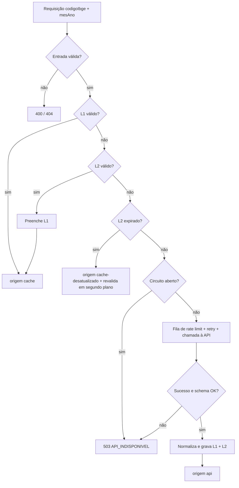

# API Bolsa Família – Módulo de Integração com a API do Governo

API Node.js que consulta os repasses do Bolsa Família **por município** no [Portal da Transparência](https://api.portaldatransparencia.gov.br/swagger-ui/index.html) e os entrega já tratados, com cache, retry, circuit breaker e controle de taxa. Implementa a Entrega 1 do Termo de Abertura (RF01, RNF01, RNF02). A especificação completa está em [`plan/2.6-Especificacao-da-API-Integracao-de-Dados.md`](plan/2.6-Especificacao-da-API-Integracao-de-Dados.md).

> Roda na **porta 3333** (e não em 3000/4200/5173/8080) para não conflitar com o front-end.

## Início rápido

```bash
cp .env.example .env && npm install && npm start
```

- Swagger UI (testar sem front): **http://localhost:3333/docs**
- OpenAPI JSON: http://localhost:3333/docs/json
- `GET /` redireciona (302) para `/docs`

Sem chave da API, o servidor sobe em **modo MOCK** automaticamente (com aviso no log), então já dá para testar tudo.

## Pré-requisitos

- Node.js **>= 22.5** (testado na 22.17). O SQLite usado é o `node:sqlite`, embutido no Node. Ele é *experimental*; os scripts já suprimem o aviso com `--disable-warning=ExperimentalWarning`.

## Como obter a chave da API

1. Acesse http://www.portaldatransparencia.gov.br/api-de-dados/cadastrar-email e cadastre seu e-mail (gratuito).
2. Coloque a chave em `.env`: `PORTAL_TRANSPARENCIA_API_KEY=sua_chave`.
3. Reinicie e (opcional) force o modo real com `USE_MOCK=false`.

A chave é segredo: fica só no `.env` (ignorado pelo git). O `.env.example` contém apenas placeholder.

## Como rodar

| Comando | O que faz |
| :-- | :-- |
| `npm start` | Sobe a API (lê `.env` se existir) |
| `npm run dev` | Igual, com `--watch` |
| `NODE_ENV=production npm start` | Produção |
| `npm test` | Roda os testes (`node --test`) |

Encerramento gracioso em `SIGINT`/`SIGTERM` (fecha o servidor, o SQLite e o agendador).

## Modo MOCK

- `USE_MOCK=true`: força mock. `USE_MOCK=false`: força API real.
- `USE_MOCK` vazio: usa mock **automaticamente, com aviso no log**, quando não há chave.
- Os dados são fictícios e determinísticos (mesmo `codigoIbge`+`mesAno` gera o mesmo resultado), no formato real. A resposta traz `meta.origem = "mock"`.
- No mock não há rede: nem Portal da Transparência, nem IBGE. Também não passa por cache, fila nem circuit breaker.
- Modo real **sem chave**: responde `502 CHAVE_API_AUSENTE_OU_INVALIDA`, sem expor detalhes.

## Frontend

Existe um dashboard web (React + Vite) em [`frontend/`](frontend/README.md) que consome esta API. Com a API em mock (`USE_MOCK=true npm start`), rode `cd frontend && npm install && npm run dev` e abra http://localhost:5173.

## Endpoints

| Rota | Descrição |
| :-- | :-- |
| `GET /api/v1/repasses?codigoIbge=4214805&mesAno=202401` | Um mês |
| `GET /api/v1/repasses?codigoIbge=4214805&de=202301&ate=202312` | Série mês a mês (`de <= ate`, máx. 36 meses) |
| `GET /api/v1/saude` | Uptime, modo, circuit breaker, taxa de sucesso externa (1 h), cache, última coleta, fila |
| `DELETE /api/v1/cache` | Invalida cache. **Só existe se `ADMIN_TOKEN` estiver definido** (senão 404). Header `x-admin-token` |
| `GET /` | 302 para `/docs` |

Sucesso: `{ consulta, dados: [...], meta: { origem, atualizadoEm } }`. `origem` pode ser `api`, `cache`, `cache-desatualizado` ou `mock`. Mês sem dados é `200` com `dados: []`.

Erro: `{ "erro": { "codigo": "...", "mensagem": "...", "tentarNovamenteEm": 60 } }` (`tentarNovamenteEm` só quando aplicável).

### Exemplos

```bash
curl "http://localhost:3333/api/v1/repasses?codigoIbge=4214805&mesAno=202401"
curl "http://localhost:3333/api/v1/repasses?codigoIbge=4214805&de=202301&ate=202312"
curl "http://localhost:3333/api/v1/saude"
# erro 400 (dígito verificador inválido)
curl -i "http://localhost:3333/api/v1/repasses?codigoIbge=1234567&mesAno=202401"
# invalidar um mês (requer ADMIN_TOKEN no .env)
curl -X DELETE -H "x-admin-token: SEU_TOKEN" "http://localhost:3333/api/v1/cache?codigoIbge=4214805&mesAno=202401"
```

Exemplo de item em `dados`:

```json
{
  "codigoIbge": "4214805", "municipio": "RIO DO SUL", "uf": "SC", "mesAno": "202401",
  "programa": "NOVO_BOLSA_FAMILIA", "tipo": { "id": 1, "descricao": "Novo Bolsa Família" },
  "valor": 1624491.21, "quantidadeBeneficiados": 2421, "valorMedio": 671.000086741016,
  "origemId": 1001421, "coletadoEm": "2026-10-08T23:24:35.228Z"
}
```

### Códigos de erro

| Código | HTTP | Quando |
| :-- | :-: | :-- |
| `CODIGO_IBGE_INVALIDO` | 400 | Não tem 7 dígitos, UF inexistente ou dígito verificador incorreto |
| `MES_ANO_INVALIDO` | 400 | Formato fora de `AAAAMM`, futuro, parâmetros ausentes, `de > ate` ou série > 36 meses |
| `MUNICIPIO_NAO_ENCONTRADO` | 404 | Código válido que não está na tabela de municípios |
| `RESPOSTA_INVALIDA` | 502 | Resposta da API externa fora do schema esperado |
| `CHAVE_API_AUSENTE_OU_INVALIDA` | 502 | Chave ausente, 401 ou 403 da API externa |
| `API_INDISPONIVEL` | 503 (502 se erro 500 externo) | API fora do ar, timeout ou circuito aberto, sem cache |
| `RATE_LIMIT_EXTERNO` | 503 | 429 da API externa, sem cache (inclui header `Retry-After`) |
| `NAO_AUTORIZADO` | 401 | `x-admin-token` ausente ou incorreto |

## Como funciona



- **Validação do código IBGE**: 7 dígitos, UF válida e dígito verificador (pesos 1,2,1,2,1,2; algoritmo conferido com 6 municípios reais). O DV é obrigatório. Depois consulta a tabela local de municípios (SQLite), carregada do IBGE na primeira execução e renovada a cada 30 dias na inicialização. Sem rede, usa a tabela salva ou uma lista embutida de 6 municípios (Rio do Sul, São Paulo, Rio de Janeiro, Brasília, Curitiba, Salvador).
- **Programa por período** (`src/config/programas.js`, *a validar*): até 202110 → `bolsa-familia-por-municipio`; 202111 a 202302 → `auxilio-brasil-por-municipio`; a partir de 202303 → `novo-bolsa-familia-por-municipio`.
- **Paginação**: pede `pagina=1,2,...` até receber array vazio (máx. 20 páginas).
- **Pipeline**: validação com `zod`, normalização, deduplicação por `codigoIBGE+mesAno+tipo.id` (fica o maior `id`), `valorMedio = valor / quantidadeBeneficiados` (`null` se a quantidade for 0). Os valores **não são arredondados**. Só dados agregados por município; nenhum dado pessoal.
- **Cliente externo**: timeout 10 s; 3 tentativas com backoff exponencial + jitter (`min(30s, 1s·2^n) + 0–500 ms`); retry em rede, timeout, 429 e 5xx; sem retry em 400/401/403/404; respeita `Retry-After`; corpo de erro decodificado como ISO-8859-1 (só para log); corpo não-JSON conta como indisponibilidade.
- **Fila**: ~60 req/min (`RATE_LIMIT_PER_MIN`), com *coalescing* de chamadas iguais. Um 429 pausa a fila.
- **Circuit breaker**: abre com 5 falhas consecutivas ou taxa de falha > 50% na janela de 1 min (mínimo de 5 chamadas); fica aberto 60 s; no semiaberto libera 1 chamada de teste.
- **Cache**: L1 `lru-cache` + L2 SQLite (`DB_PATH`). Chave `repasse:v1:{codigoIbge}:{mesAno}`. TTL L1 / validade L2: mês com mais de 3 meses 24 h / 30 d; últimos 3 meses 6 h / 3 d; mês corrente 1 h / 1 d; resultado vazio 15 min / 1 h. Dado expirado é servido na hora (*stale-while-revalidate*) e atualizado em segundo plano; se a API falha, segue servindo-o como `cache-desatualizado`. Resposta inválida nunca sobrescreve cache válido.
- **Métrica de sucesso**: requisições externas bem-sucedidas na última hora em `/api/v1/saude`, com `warn` no log se ficar abaixo de 95% (com ao menos 10 amostras).
- **Pré-carga (opcional)**: `PRELOAD_ENABLED=true` agenda `node-cron` às 02:00 (America/Sao_Paulo) para atualizar o mês atual e os 2 anteriores de `PRELOAD_CODIGO_IBGE`; na primeira execução carrega 24 meses. Usa no máximo 50% da fila. Ignorada em mock.

## Variáveis de ambiente

| Variável | Padrão | Descrição |
| :-- | :-- | :-- |
| `PORT` | `3333` | Porta HTTP |
| `HOST` | `0.0.0.0` | Interface |
| `NODE_ENV` | `development` | Ambiente |
| `LOG_LEVEL` | `info` | Nível do pino |
| `LOG_PRETTY` | `false` | Logs legíveis (`pino-pretty`, devDependency; só fora de produção) |
| `CORS_ORIGIN` | `*` | Origem(ns) permitida(s), separadas por vírgula |
| `PORTAL_TRANSPARENCIA_API_KEY` | vazio | Chave da API (segredo) |
| `USE_MOCK` | indefinido | `true`/`false`; vazio = mock automático sem chave |
| `DB_PATH` | `./data/cache.sqlite` | Arquivo SQLite (`:memory:` aceito) |
| `ADMIN_TOKEN` | vazio | Habilita `DELETE /api/v1/cache` |
| `RATE_LIMIT_PER_MIN` | `60` | Requisições/min à API externa |
| `HTTP_TIMEOUT_MS` | `10000` | Timeout por chamada |
| `RETRY_ATTEMPTS` | `3` | Total de tentativas |
| `RETRY_BASE_MS` | `1000` | Base do backoff |
| `CB_FAILURE_THRESHOLD` | `5` | Falhas consecutivas para abrir o circuito |
| `CB_FAILURE_RATE` | `0.5` | Taxa de falha para abrir |
| `CB_WINDOW_MS` | `60000` | Janela da taxa |
| `CB_OPEN_MS` | `60000` | Tempo com circuito aberto |
| `PRELOAD_ENABLED` | `false` | Liga a pré-carga |
| `PRELOAD_CODIGO_IBGE` | `4214805` | Município da pré-carga |
| `IBGE_MUNICIPIOS_URL` | API de localidades do IBGE | Fonte da tabela de municípios |

## Estrutura de pastas

```
src/
  server.js            # inicialização e encerramento gracioso
  app.js               # monta o Fastify (CORS, Swagger, rotas, injeção de dependências)
  config/              # env (zod) e mapeamento programa/endpoint
  routes/              # repasses, saude, cache (+ schemas compartilhados)
  services/            # repassesService (fluxo principal), municipiosService
  clients/             # portalTransparenciaClient (real) e mockClient
  cache/               # cacheL1 (lru), cacheL2 (SQLite), cacheManager (TTLs)
  resilience/          # retry, circuitBreaker, rateLimiter, coalescer, successMetrics
  domain/              # codigoIbge, mesAno, normalizer, schemas (zod), errors
  jobs/                # preload (node-cron)
test/                  # node --test
```

## Testes

```bash
npm test
```

Usam apenas `node --test` (sem framework extra), sem rede e sem chave. Cobrem: validação de `codigoIbge`/`mesAno`, normalizador e `valorMedio` (divisão por zero), retry/backoff com cliente falso (`fetchImpl`), circuit breaker, fluxo de cache (miss, hit, stale-on-error, resposta inválida, cache negativo, coalescing, persistência em SQLite) e rotas via `app.inject` (inclui mascaramento da chave nos logs). Arquivos temporários ficam em `os.tmpdir()` e são removidos ao final.

## Segurança

- A chave vem só de variável de ambiente. O logger (pino) mascara `chave-api-dados`, `authorization` e `x-admin-token`; a chave nunca é logada.
- `.env` e `data/` estão no `.gitignore`.
- `CORS_ORIGIN=*` é apenas para desenvolvimento; restrinja em produção.
- A API **não tem autenticação** nas rotas de consulta (são dados públicos agregados). Só o `DELETE /api/v1/cache` exige token, comparado em tempo constante.

## Decisões de stack

- **ESM** e **Fastify 5** (schemas nativos e Swagger). Dependências com versões exatas.
- **`node:sqlite`** em vez de `better-sqlite3` (sem compilação nativa). Todo o acesso fica isolado em `src/cache/cacheL2.js` para facilitar uma troca futura.
- **`--env-file-if-exists`** do Node no lugar de `dotenv`.
- O `pino` não é dependência direta: usa-se o logger embutido do Fastify.

## Limitações

- Em modo mock não há rede, então a lista completa do IBGE não é baixada: só os 6 municípios embutidos (ou os já salvos em `DB_PATH`) são aceitos; os demais retornam 404.
- `node:sqlite` é experimental. Uma instância por processo (cache em arquivo não é pensado para múltiplas réplicas).
- Fila e circuit breaker ficam em memória e reiniciam com o processo.
- Revalidação em segundo plano: a resposta stale sai na hora e o dado novo só aparece na consulta seguinte.
- Meses futuros são recusados com 400.

## Itens a validar (exigem chave real)

Nada abaixo foi testado contra a API real do governo, pois o desenvolvimento não teve chave.

1. Limites reais (90 req/min diurno, 300 req/min madrugada); o padrão de 60 req/min é conservador.
2. Se a API devolve `429` e `Retry-After` (tratado de forma defensiva).
3. Formato real de `dataReferencia`, grafia de `nomeIBGE` e `tipo.descricao` (o normalizador aceita `YYYY-MM-DD`, `DD/MM/YYYY` e `AAAAMM`).
4. Meses exatos de transição entre Bolsa Família, Auxílio Brasil e Novo Bolsa Família.
5. Se os últimos meses recebem ajustes após a publicação (define os TTLs de 6 h / 3 d).
6. Se `pagina` é opcional no Novo Bolsa Família (o cliente sempre envia).
7. Meta de ≥ 95% de sucesso medida contra a API real; resposta a 401/403 com chave inválida; decodificação ISO-8859-1 dos erros.
8. Estrutura real do JSON de municípios do IBGE (o mapeamento aceita dois formatos, mas precisa ser confirmado com rede).
9. O `schema` zod exige `municipio.uf.sigla` e `tipo.descricao`; se a API real omitir algum, a resposta será rejeitada com `RESPOSTA_INVALIDA`.
