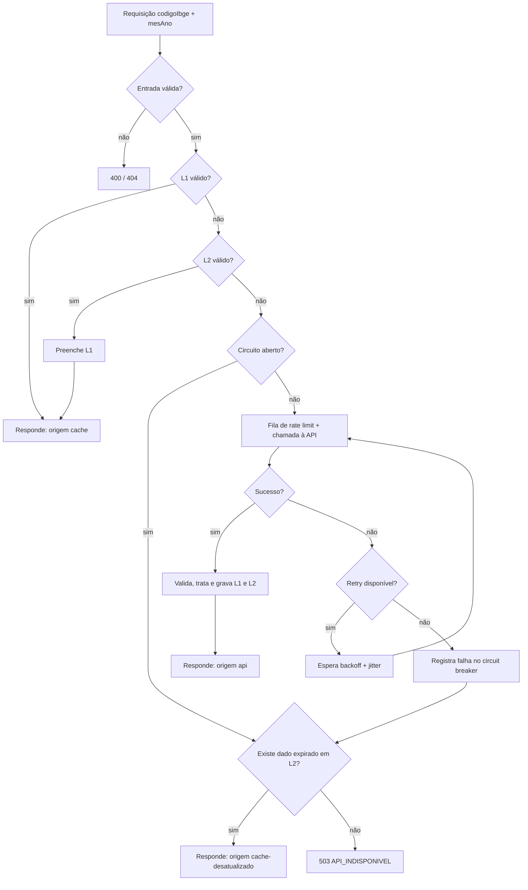

# Especificação da API – Planejamento da Integração de Dados (EAP 2.6)

| Versão | Data | Autor | Notas |
| :---: | :---: | :---: | :--- |
| 1.0 | 08/10/2026 | Equipe do projeto | Versão inicial |

## Objetivo e escopo

Este documento especifica o **Módulo de Integração com a API do Governo** (Entrega 1 do Termo de Abertura). Ele serve de base para a fase de Execução 3.1. O escopo se limita aos requisitos:

| Requisito | Descrição |
| :--- | :--- |
| **RF01** | Consultar automaticamente os dados utilizando o código IBGE do município. |
| **RNF01** | Tratar erros de conexão, limite de requisições (rate limit) e indisponibilidade da API externa. |
| **RNF02** | Armazenar e fazer *caching* dos dados extraídos para otimizar o tempo de resposta. |

Dashboard, filtros, exportação e publicação ficam fora deste documento. Esses módulos apenas consomem os dados entregues por esta API.

**Tecnologia:** a API do projeto será desenvolvida em **Node.js**. Os demais componentes são propostas.

| Camada | Proposta | Motivo |
| :--- | :--- | :--- |
| Runtime | Node.js 22 LTS | Versão LTS com `fetch` nativo e `AbortSignal.timeout` |
| Framework HTTP | Fastify (alternativa: Express) | Validação de schema nativa e bom desempenho |
| Cliente HTTP | `fetch` nativo (undici) | Não exige dependência extra |
| Cache em memória (L1) | `lru-cache` | Leituras rápidas |
| Armazenamento persistente (L2) | SQLite (alternativa: PostgreSQL) | Sobrevive a reinícios e serve de reserva quando a API falha |
| Validação de dados | `zod` | Valida o formato da resposta externa |
| Agendamento | `node-cron` | Pré-carga em horário de maior limite |
| Logs | `pino` | Logs estruturados para medir a taxa de sucesso |

> Itens **a validar** não puderam ser confirmados em fonte oficial e precisam ser conferidos com a chave de acesso em mãos.

---

## 2.6.1 Identificar API

| Item | Definição |
| :--- | :--- |
| Nome | API REST do Portal da Transparência do Governo Federal |
| Responsável | Controladoria-Geral da União (CGU), Diretoria de Tecnologia da Informação (listaapitransparencia@cgu.gov.br) |
| URL base | `https://api.portaldatransparencia.gov.br` |
| Prefixo dos recursos | `/api-de-dados` |
| Swagger | https://api.portaldatransparencia.gov.br/swagger-ui/index.html |
| Especificação OpenAPI | https://api.portaldatransparencia.gov.br/v3/api-docs |
| Autenticação | Chave gratuita no header **`chave-api-dados`**. Cadastro em http://www.portaldatransparencia.gov.br/api-de-dados/cadastrar-email |
| Formato | JSON. As respostas de erro vêm em `charset=ISO-8859-1` |
| Paginação | Parâmetro `pagina` (padrão 1). A resposta é um array JSON |
| Base legal | Decreto nº 8.777/2016 (Política de Dados Abertos) |
| Limite de requisições | 90 req/min das 06:00 às 23:59 e 300 req/min das 00:00 às 05:59 (**a validar**: valores citados pela comunidade, não confirmados na documentação oficial) |

**Verificação realizada em 08/10/2026.** Uma chamada sem chave a `novo-bolsa-familia-por-municipio` retornou **HTTP 401** com o corpo abaixo. Isso confirma o header obrigatório e o formato de erro. A resposta passa por CDN (CloudFront).

```json
{"Erro na API":"Chave de API não informada! Para obter a chave acesse http://www.portaldatransparencia.gov.br/api-de-dados/cadastrar-email"}
```

**Justificativa.** É a fonte oficial e gratuita exigida pelas restrições do Termo. Também atende ao critério de sucesso 2 (valores idênticos aos do Portal).

### Endpoints selecionados e descartados

| Endpoint (`/api-de-dados/...`) | Decisão | Motivo |
| :--- | :--- | :--- |
| `novo-bolsa-familia-por-municipio` | **Usado (principal)** | Dados agregados por município do programa atual |
| `auxilio-brasil-por-municipio` | **Usado (histórico)** | Período em que o programa se chamava Auxílio Brasil |
| `bolsa-familia-por-municipio` | **Usado (histórico)** | Período do Bolsa Família anterior |
| `*-sacado-beneficiario-por-municipio`, `*-disponivel-beneficiario-por-municipio` | Descartado | Retornam dados por beneficiário (pessoa física), desnecessários e arriscados para a LGPD |
| `*-por-nis`, `*-por-cpf-ou-nis` | Descartado | Consultas de dados pessoais, fora do escopo |

### Segredo da chave

A chave é um segredo. Fica em variável de ambiente (`PORTAL_TRANSPARENCIA_API_KEY`), nunca no repositório, que é público (Open Source). O repositório terá apenas um `.env.example` sem valor real.

---

## 2.6.2 Identificar dados do Bolsa Família

### Requisição

Os três endpoints têm a mesma assinatura e o mesmo schema de resposta (`BeneficioPorMunicipioDTO`).

| Parâmetro | Local | Tipo | Obrigatório | Formato |
| :--- | :--- | :--- | :---: | :--- |
| `mesAno` | query | integer | Sim | `AAAAMM`, ex.: `202401` |
| `codigoIbge` | query | string | Sim | 7 dígitos, ex.: `4214805` |
| `pagina` | query | integer | Sim nos endpoints históricos; opcional no Novo Bolsa Família | padrão `1` |
| `chave-api-dados` | header | string | Sim | chave pessoal (segredo) |

```bash
curl -s \
  -H "chave-api-dados: <SUA_CHAVE>" \
  -H "Accept: application/json" \
  "https://api.portaldatransparencia.gov.br/api-de-dados/novo-bolsa-familia-por-municipio?mesAno=202401&codigoIbge=4214805&pagina=1"
```

O Swagger documenta as respostas `200`, `400`, `401` e `500`. O `429` não consta, mas deve ser tratado (ver 2.6.5).

### Resposta

Estrutura conforme o Swagger. Os valores do exemplo são ilustrativos.

```json
[
  {
    "id": 0,
    "dataReferencia": "2024-01-01",
    "municipio": {
      "codigoIBGE": "4214805",
      "nomeIBGE": "RIO DO SUL",
      "codigoRegiao": "4",
      "nomeRegiao": "SUL",
      "pais": "BRASIL",
      "uf": { "sigla": "SC", "nome": "SANTA CATARINA" }
    },
    "tipo": { "id": 0, "descricao": "...", "descricaoDetalhada": "..." },
    "valor": 0.0,
    "quantidadeBeneficiados": 0
  }
]
```

A grafia real de `nomeIBGE`, `tipo.descricao` e o formato de `dataReferencia` estão **a validar** com uma chamada autenticada.

### Dicionário de dados

| Campo | Tipo | Descrição | Uso no sistema |
| :--- | :--- | :--- | :--- |
| `id` | integer | Identificador do registro na API | Rastreabilidade e deduplicação |
| `dataReferencia` | string (date) | Mês de referência | Convertido para `AAAAMM` |
| `municipio.codigoIBGE` | string | Código IBGE do município | Chave de consulta e de cache |
| `municipio.nomeIBGE` | string | Nome do município | Exibição |
| `municipio.codigoRegiao`, `nomeRegiao` | string | Região geográfica | Contexto (opcional) |
| `municipio.pais` | string | País | Não utilizado |
| `municipio.uf.sigla`, `uf.nome` | string | Unidade da Federação | Exibição |
| `tipo.id`, `descricao`, `descricaoDetalhada` | integer / string | Tipo de benefício | Identificar o programa na série |
| `valor` | number | Valor repassado no mês ao município (R$) | Montante total |
| `quantidadeBeneficiados` | integer | Beneficiados no mês | Famílias beneficiadas |

### Cobertura temporal e transição entre programas

| Período (**a validar** nos dados) | Programa | Endpoint |
| :--- | :--- | :--- |
| até out/2021 | Bolsa Família | `bolsa-familia-por-municipio` |
| nov/2021 a fev/2023 | Auxílio Brasil | `auxilio-brasil-por-municipio` |
| a partir de mar/2023 | Novo Bolsa Família | `novo-bolsa-familia-por-municipio` |

- O mapeamento período → endpoint fica em um único módulo de configuração. Se a API mudar ou o programa for substituído (riscos do Termo), só esse módulo é alterado.
- A API devolve uma resposta vazia (`[]`) para meses sem dados. O módulo deve tratar isso como "sem dados" e não como erro (ver 2.6.4).

---

## 2.6.3 Definir código IBGE

### Definição

- Código de **7 dígitos** do município no IBGE.
- Os 2 primeiros dígitos identificam a UF (ex.: `42` = Santa Catarina).
- O último dígito é verificador.
- Exemplo: **Rio do Sul/SC = `4214805`** (confirmado na API de localidades do IBGE em 08/10/2026).

### Fonte oficial da lista de municípios

API de localidades do IBGE: `https://servicodados.ibge.gov.br/api/v1/localidades/municipios` (lista completa) e `.../municipios/{id}` (consulta individual).

### Validação de entrada (RF01)

| Regra | Ação se falhar |
| :--- | :--- |
| Deve conter exatamente 7 dígitos numéricos (`/^\d{7}$/`) | Retornar `400` com mensagem clara, sem chamar a API externa |
| Os 2 primeiros dígitos devem ser um código de UF válido | Retornar `400` |
| Dígito verificador válido (algoritmo do IBGE) (**proposta**) | Retornar `400` |
| Deve existir na tabela local de municípios | Retornar `404` |

Entradas com 6 dígitos (código sem verificador) não são aceitas. O módulo não deve completar o código automaticamente, para não consultar o município errado.

### Tabela local de municípios

- Carregada da API do IBGE na primeira execução e armazenada no banco (código, nome, UF).
- Atualizada em rotina mensal. Se a API do IBGE falhar, o sistema usa a última tabela salva.
- Evita uma chamada ao IBGE a cada requisição e permite validar o código antes de gastar o limite da API do Portal.

---

## 2.6.4 Definir tratamento dos dados

Etapas do pipeline, executadas pelo módulo antes de gravar no cache e devolver ao consumidor.

| Etapa | Regra |
| :--- | :--- |
| 1. Validação de schema | `zod` valida a resposta. Campo obrigatório ausente ou de tipo errado invalida o registro e gera log de alerta (mudança de estrutura, risco do Termo) |
| 2. Paginação | Repetir `pagina=1,2,...` até receber array vazio. Limite de segurança de páginas (**proposta**: 20) para evitar laço infinito |
| 3. Normalização de tipos | `valor` como número com 2 casas (ou centavos inteiros); `quantidadeBeneficiados` como inteiro; `codigoIBGE` como string de 7 dígitos |
| 4. Normalização de data | `dataReferencia` convertida para `mesAno` (`AAAAMM`) |
| 5. Nomes | Remover espaços extras. O texto original da API é preservado (sem alterar o conteúdo) |
| 6. Deduplicação | Chave `codigoIBGE + mesAno + tipo.id`. Em caso de duplicata, mantém o registro de maior `id` e registra log |
| 7. Resposta vazia | Gravar o resultado como "sem dados" (cache negativo) e retornar lista vazia com status `200` |
| 8. Valores zero | `valor = 0` ou `quantidadeBeneficiados = 0` são preservados como vieram |

### Campos derivados

| Campo | Cálculo | Observação |
| :--- | :--- | :--- |
| `valorMedio` | `valor / quantidadeBeneficiados` | Se `quantidadeBeneficiados = 0`, retornar `null` (nunca dividir por zero) |

### Modelo interno normalizado (proposta)

```json
{
  "codigoIbge": "4214805",
  "municipio": "RIO DO SUL",
  "uf": "SC",
  "mesAno": "202401",
  "programa": "NOVO_BOLSA_FAMILIA",
  "valor": 0.0,
  "quantidadeBeneficiados": 0,
  "valorMedio": null,
  "origemId": 0,
  "coletadoEm": "2026-10-08T12:00:00Z"
}
```

### Garantias

- Os valores são repassados **sem arredondamento nem ajuste**, de modo que fiquem idênticos aos do Portal (critério de sucesso 2).
- Apenas dados agregados por município são tratados. O módulo não coleta nem armazena dados pessoais (CPF, NIS, nome de beneficiário), em conformidade com a LGPD.

### Contrato da API do módulo (proposta)

| Método e rota | Descrição |
| :--- | :--- |
| `GET /api/v1/repasses?codigoIbge=4214805&mesAno=202401` | Retorna o registro de um mês |
| `GET /api/v1/repasses?codigoIbge=4214805&de=202301&ate=202412` | Retorna uma série de meses |
| `GET /api/v1/saude` | Estado do módulo (cache, última coleta, circuito) |

Cada resposta inclui o campo `meta.origem` (`cache`, `api` ou `cache-desatualizado`) e `meta.atualizadoEm`.

---

## 2.6.5 Definir estratégia de cache e tratamento de erros da API (RNF01)

> **Nota sobre 2.6.5 e 2.6.6.** Os dois títulos são quase idênticos no Termo de Abertura. Aqui, a 2.6.5 trata do **tratamento de erros** (RNF01). A 2.6.6 trata do **armazenamento e do cache** (RNF02) combinado com o tratamento de erros.

### Cenários de erro

| Cenário | Detecção | Ação | Resposta ao consumidor |
| :--- | :--- | :--- | :--- |
| Falha de conexão (DNS, reset, rede) | Exceção do `fetch` | Retry com backoff | Se esgotar: dados em cache, senão `503` |
| Timeout | `AbortSignal.timeout` (**proposta**: 10 s) | Retry com backoff | Idem |
| Rate limit | HTTP `429` (ou `Retry-After`) | Respeitar `Retry-After`; senão backoff. Pausar a fila de chamadas | Cache, senão `503` com `Retry-After` |
| Indisponibilidade | HTTP `502`, `503`, `504` | Retry com backoff | Cache, senão `503` |
| Erro interno da API | HTTP `500` | Retry (máx. 2) | Cache, senão `502` |
| Chave ausente ou inválida | HTTP `401`/`403` | **Sem retry**; alerta crítico no log | `502` (falha de configuração, sem expor detalhes) |
| Parâmetro inválido | HTTP `400` | **Sem retry**; log do parâmetro | `400` ao consumidor, se a validação local falhou |
| Resposta fora do schema | Falha no `zod` | Sem retry; alerta de mudança de estrutura | Cache, senão `502` |
| Corpo não é JSON (ex.: HTML de erro da CDN) | Falha no `JSON.parse` | Tratar como indisponibilidade | Cache, senão `503` |

Observação: o corpo de erro vem em ISO-8859-1. Ao ler o corpo de erro, decodificar com `TextDecoder('iso-8859-1')` para o log ficar legível.

### Retry com backoff exponencial e jitter (proposta)

| Parâmetro | Valor |
| :--- | :--- |
| Tentativas | 3 (1 inicial + 2 retries) |
| Espera | `min(30 s, 1 s × 2^tentativa) + jitter aleatório de 0 a 500 ms` |
| Códigos com retry | Falha de rede, timeout, `429`, `500`, `502`, `503`, `504` |
| Códigos sem retry | `400`, `401`, `403`, `404` |

### Controle de taxa

- Fila interna com limite de **~60 req/min** (**proposta**, abaixo dos 90 req/min da faixa diurna, **a validar**). Isso evita chegar ao `429`.
- Requisições concorrentes ao mesmo `codigoIbge + mesAno` são unidas em uma só chamada (*request coalescing*).

### Circuit breaker (proposta)

| Estado | Condição | Comportamento |
| :--- | :--- | :--- |
| Fechado | Operação normal | Chamadas passam |
| Aberto | 5 falhas consecutivas ou taxa de falha > 50% em 1 min | Não chama a API por 60 s e responde pelo cache |
| Semiaberto | Após 60 s | Libera 1 chamada de teste. Sucesso fecha o circuito; falha reabre |

### Fallback e monitoramento

- Em qualquer falha após os retries, o módulo devolve os dados em cache, mesmo expirados, com `meta.origem = "cache-desatualizado"` (detalhes em 2.6.6).
- Sem cache disponível, retorna erro padronizado:

```json
{ "erro": { "codigo": "API_INDISPONIVEL", "mensagem": "Não foi possível obter os dados no momento.", "tentarNovamenteEm": 60 } }
```

- **Meta de 95% de sucesso** (objetivo 1 do Termo): o módulo mede `requisições bem-sucedidas / total` para a API externa e registra em log estruturado e em `/api/v1/saude`. Taxa abaixo de 95% em uma janela de 1 hora gera alerta no log.
- Nunca registrar a chave da API nos logs (mascarar o header `chave-api-dados`).

---

## 2.6.6 Definir estratégia de cache e tratamento de erros da API (RNF01 e RNF02)

### O que é armazenado

Os registros já tratados (modelo da 2.6.4) por `codigoIbge + mesAno`, mais os metadados `coletadoEm` e `expiraEm`. Também são armazenados resultados "sem dados" (cache negativo).

### Camadas

| Camada | Tecnologia (proposta) | Função |
| :--- | :--- | :--- |
| L1 | `lru-cache` em memória | Resposta imediata (meta de consulta < 2 s do Termo) |
| L2 | SQLite/PostgreSQL | Persistência entre reinícios e reserva quando a API falha |

### Chave e TTL

Chave: `repasse:{codigoIbge}:{mesAno}`.

| Tipo de dado | TTL L1 | Validade L2 (`expiraEm`) | Justificativa |
| :--- | :--- | :--- | :--- |
| Meses passados (mais de 3 meses atrás) | 24 h | 30 dias | Dados quase imutáveis |
| Últimos 3 meses | 6 h | 3 dias | Podem receber ajustes (**a validar**) |
| Mês corrente | 1 h | 1 dia | Pode ainda não existir |
| Resultado vazio (cache negativo) | 15 min | 1 h | Evita repetir consultas a meses sem publicação |

Os valores são propostas e devem ser ajustados após medir a frequência real de atualização dos dados.

### Fluxo de leitura (stale-while-revalidate / serve-stale-on-error)

1. Consulta L1. Se estiver válido, responde.
2. Consulta L2. Se estiver válido, preenche L1 e responde.
3. Se estiver expirado, responde imediatamente com o dado antigo e atualiza em segundo plano, se o circuito estiver fechado.
4. Se não houver dado, chama a API (com fila, retry e circuit breaker da 2.6.5), trata, grava em L1 e L2 e responde.
5. Se a API falhar e existir dado expirado em L2, devolve o dado expirado com `meta.origem = "cache-desatualizado"`.
6. Se a API falhar e não houver dado, devolve o erro padronizado da 2.6.5.



### Pré-carga (aquecimento)

- Rotina agendada às **02:00** (faixa de limite maior, 300 req/min, **a validar**) que atualiza o mês corrente e os 2 meses anteriores dos municípios mais consultados. Para este projeto, o foco inicial é **Rio do Sul/SC (`4214805`)**, citado no Termo.
- Na primeira execução, carrega os últimos 24 meses do município configurado.
- O orçamento da pré-carga respeita a mesma fila de rate limit, usando no máximo 50% da capacidade para não competir com as consultas dos usuários.

### Invalidação

| Gatilho | Ação |
| :--- | :--- |
| TTL expirado | Dado é atualizado conforme o fluxo de leitura |
| Endpoint administrativo protegido (**proposta**) | Remove a chave de um município/mês |
| Falha de schema (mudança da API) | Não grava o dado novo; mantém o anterior e emite alerta |
| Mudança de versão do modelo interno | Invalida todo o cache por versão de chave (`v1:`) |

### Interação cache x erros (RNF01 + RNF02)

| Situação | Comportamento |
| :--- | :--- |
| API OK | Atualiza o cache e responde |
| API com `429` | Pausa a fila, usa o cache e retoma após `Retry-After` |
| API fora do ar | Circuito abre, responde pelo cache desatualizado até o fechamento |
| Resposta inválida | Não sobrescreve o cache válido |
| Sem cache e API fora | Erro `503` padronizado |

---

## Rastreabilidade

| Requisito | Seções |
| :--- | :--- |
| RF01 (consulta por código IBGE) | 2.6.1, 2.6.2, 2.6.3, 2.6.4 |
| RNF01 (erros, rate limit, indisponibilidade) | 2.6.5, 2.6.6 |
| RNF02 (armazenamento e cache) | 2.6.6 |

## Itens a validar

1. Limites de requisição (90 e 300 req/min e faixas de horário) na documentação oficial ou com a chave.
2. Se a API retorna `429` e o header `Retry-After`.
3. Formato real de `dataReferencia`, `nomeIBGE` e `tipo.descricao`.
4. Meses de transição entre Bolsa Família, Auxílio Brasil e Novo Bolsa Família.
5. Se os dados dos últimos meses recebem ajustes depois da publicação (define o TTL).
6. Se `pagina` é realmente opcional no endpoint Novo Bolsa Família (o Swagger a marca como não obrigatória).

## Referências

- Swagger: https://api.portaldatransparencia.gov.br/swagger-ui/index.html
- OpenAPI: https://api.portaldatransparencia.gov.br/v3/api-docs
- Cadastro da chave: http://www.portaldatransparencia.gov.br/api-de-dados/cadastrar-email
- API de localidades do IBGE: https://servicodados.ibge.gov.br/api/v1/localidades/municipios
- Limites de requisição citados pela comunidade: https://github.com/BrasilAPI/BrasilAPI/issues/127
- Termo de Abertura do Projeto: `plan/1a-Termo de Abertura do Projeto.docx.md`
